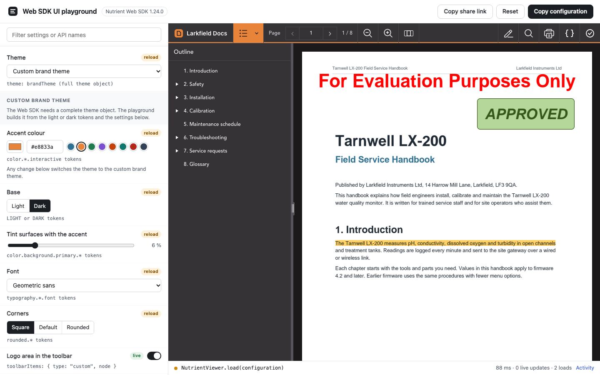
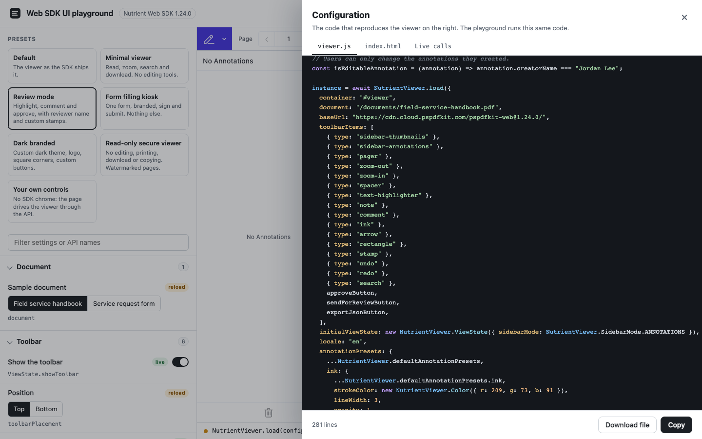
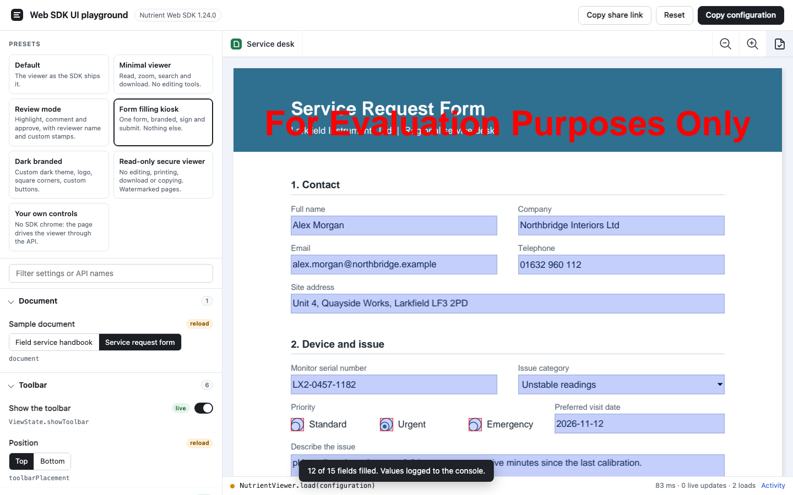

# Nutrient Web SDK UI Customization Playground

A Nutrient.io demo that shows how far the user interface of the Nutrient Web SDK can be customised: a settings panel next to a live viewer, every change applied at once, and the exact JavaScript that reproduces the result.



1. **Settings panel.** 84 settings in nine sections (document, toolbar, custom buttons and popovers, theme and branding, features, view, annotations, language, UI slots) and an editable list of 54 toolbar items. Each setting shows the Web SDK API it uses.
2. **Live or reload.** A change is applied to the running viewer with an instance method when the SDK has one (`setToolbarItems`, `setViewState`, `setAnnotationPresets`, `setStampAnnotationTemplates`, `setLocale`, `setUI`, ...). Options that `NutrientViewer.load()` reads only once (theme, toolbar placement, style sheets, disabled features) unload the viewer and load it again on the same page. Each control is labelled `live` or `reload`, and the status bar shows the last call and how long it took.
3. **One source for the viewer and the code.** Load options and runtime calls are built from one description of the state. Custom buttons, callbacks and UI slots are written once as JavaScript source: the playground compiles that source and passes it to the SDK, and the code generator copies the same text. The code you copy is the code that runs.
4. **Copy configuration.** Shows and copies `viewer.js` (load options, custom buttons, calls after load), `index.html`, and when used `brand-theme.js` (the complete custom theme object) and `viewer-overrides.css`. A **Live calls** tab lists the runtime calls made since the last load.
5. **Presets.** One-click profiles: minimal viewer, review mode, form filling kiosk, dark branded, read-only secure viewer, and a viewer driven only by your own page buttons.
6. **Shareable.** The configuration is kept in the URL hash, so a link opens the playground in the same state.
7. **Tested.** A Playwright suite of 79 tests switches the settings in the panel and checks the effect in the viewer. Eight of them run the generated files on a blank page and compare the resulting viewer with the playground's.

Nutrient Web SDK 1.24.0 runs in the browser with WebAssembly, loaded from the Nutrient CDN. There is no backend.

## Prerequisites

- Node.js 20 or later and npm
- Internet access to `cdn.cloud.pspdfkit.com`, where the page loads the Web SDK from
- A current Chromium, Firefox or Safari browser, on Windows, macOS or Linux
- For the tests: Chromium for Playwright (`npx playwright install chromium`)
- Python 3.10 or later, only to regenerate the sample documents

## Environment variables

Copy `.env.example` to `.env`. Vite reads it when it starts. The license key is only read from the environment, never from code.

| Variable | Purpose | Default |
|---|---|---|
| `VITE_NUTRIENT_LICENSE_KEY` | Nutrient Web SDK license key | empty = evaluation mode |
| `PORT` | Port of the dev and preview server | `4610` |
| `DEPLOY_BASE` | Sub-path the build is served from, for example `/ui-playground/` | `/` |

In evaluation mode the viewer shows an evaluation watermark on every page. Everything else works. The generated code never contains the key.

## Build and run

```bash
npm install
```

```bash
cp .env.example .env
```

```bash
npm run dev
```

Open <http://localhost:4610>.

To build a static site in `dist/` and serve it locally:

```bash
npm run build
```

```bash
npm run preview
```

The build only holds the playground and the two sample PDFs. The Web SDK comes from the CDN, so nothing else needs to be hosted.

## Using the app

1. **Pick a preset** at the top of the panel, or start from **Default**, the viewer as the SDK ships it.
2. **Change settings.** A `live` setting changes the viewer immediately. A `reload` setting loads the viewer again and keeps the current page. Type in **Filter settings** to find a setting by its label or its API name, for example `setLocale` or `ViewState`.
3. **Try the custom buttons.** **Export JSON** downloads the annotations as Instant JSON, **Approve** adds an Approved stamp to the current page, **Send for review** opens a dialog of the host page, and **Submit form** reads the form field values. Select an annotation to see **Copy as JSON** in its toolbar and **Info** and **Duplicate** in its popover. Select some text to see **Copy quote** and **Search** in the text popover.
4. **Copy configuration.** The button copies `viewer.js` and opens the generated files. **Download file** saves the current tab. **Activity** in the status bar lists every call with its duration.

   

5. **Share link** copies the address of the page. It holds the configuration.
6. **Your own controls.** **Drive the viewer from your own buttons** hides the SDK toolbar and adds a bar of plain HTML buttons above the viewer: page navigation, zoom, thumbnails, highlight and draw modes, search, print and download. With **Built-in UI: Minimal** nothing of the SDK interface is left, only the page canvas.

The **Form filling kiosk** preset opens the service request form with a branded toolbar that only keeps zoom and a **Submit form** button. Text selection is off, and the signature dialog only offers typing and drawing.



## What the playground demonstrates

The table lists every setting with the Web SDK API it uses. `instance` is the object `NutrientViewer.load()` resolves with.

### Toolbar

| Setting | API | Applied |
|---|---|---|
| Show the toolbar | `ViewState.showToolbar` | live, `instance.setViewState()` |
| Position top or bottom | `toolbarPlacement: NutrientViewer.ToolbarPlacement.BOTTOM` | reload |
| Show, hide and reorder 54 items (built-in, extra and custom) | `toolbarItems`, `instance.setToolbarItems()` | live |
| Group the annotation tools (small screens, always, never) | `mediaQueries` of the built-in `annotate` responsive group | live |
| Group the custom buttons in one dropdown | `ToolbarItem.dropdownGroup` | live |
| Drive the viewer from your own buttons | `showToolbar: false`, `setViewState()`, `zoomIn()`, `zoomOut()`, `startUISearch()`, `print()`, `exportPDF()` | live |

### Custom buttons and popovers

| Setting | API | Applied |
|---|---|---|
| Export JSON button | `{ type: "custom", icon, onPress }`, `instance.exportInstantJSON()` | live |
| Approve button | `instance.create(new NutrientViewer.Annotations.StampAnnotation())` | live |
| Send for review button | `onPress` opens a `<dialog>` of the host page | live |
| Submit form button | `instance.getFormFieldValues()` | live |
| Copy as JSON in the annotation toolbar | `annotationToolbarItems`, `instance.setAnnotationToolbarItems()`, `NutrientViewer.Annotations.toSerializableObject()` | live |
| Copy quote and Search in the text popover | `inlineTextSelectionToolbarItems`, `instance.setInlineTextSelectionToolbarItems()`, `instance.getTextSelection()` | live |
| Hide the built-in markup buttons of the text popover | `defaultItems` of the same callback | live |
| Info and Duplicate in the annotation popover | `annotationTooltipCallback`, `instance.duplicateSelectedAnnotations()` | reload |

### Theme and branding

| Setting | API | Applied |
|---|---|---|
| Light, dark, auto, high contrast light and dark | `theme: NutrientViewer.Theme.*` | reload |
| Custom brand theme: accent colour, light or dark base, surface tint, font, square or rounded corners | `theme: brandTheme`, a complete theme object (color, typography and rounded tokens) | reload |
| Logo area with a brand name | `{ type: "custom", node }` toolbar item | live |
| Custom CSS | `styleSheets` with the public `PSPDFKit-*` classes | reload |

### Features

| Setting | API | Applied |
|---|---|---|
| Read-only | `ViewState.readOnly` | live |
| Who can edit annotations: everyone, only the author, nobody | `isEditableAnnotation`, `instance.setIsEditableAnnotation()`, `instance.setEditableAnnotationTypes([])` | live |
| Show annotations | `ViewState.showAnnotations` (requires read-only) | live |
| Forms | `disableForms` | reload |
| Printing allowed, download allowed | `ViewState.allowPrinting`, `ViewState.allowExport` | live |
| Print quality | `printOptions.quality` | reload |
| Text selection, block copying | `disableTextSelection`, `preventTextCopy` | reload |
| Undo and redo | `enableHistory` and the `undo` and `redo` items | reload |
| Signature creation modes | `electronicSignatures.creationModes` | reload |
| Show comments, comment display | `ViewState.showComments`, `ViewState.commentDisplay` | live |
| Watermark | `renderPageCallback` | reload |
| Print, download, search, document editor, content editor, form creator, sidebars, signatures, comments, measurement, redaction buttons | toolbar items `print`, `export-pdf`, `search`, `document-editor`, `content-editor`, `form-creator`, `sidebar-*`, `signature`, `comment`, `measure`, `redact-text-highlighter` | live |

### View

| Setting | API | Applied |
|---|---|---|
| Initial page | `ViewState.currentPageIndex` | live |
| Zoom: auto, fit to width, fit page, 50 to 200 % | `ViewState.zoom` | live |
| Layout single, double, auto, cover page on its own | `ViewState.layoutMode`, `ViewState.keepFirstSpreadAsSinglePage` | live |
| Scrolling continuous, per page, disabled | `ViewState.scrollMode` | live |
| Spread and page spacing | `ViewState.spreadSpacing`, `ViewState.pageSpacing` | live |
| Rotation | `ViewState.pagesRotation` | live |
| Open sidebar and its side | `ViewState.sidebarMode`, `ViewState.sidebarPlacement` | live |

### Annotations, language and UI slots

| Setting | API | Applied |
|---|---|---|
| Author name | `instance.setAnnotationCreatorName()` | live |
| Default styles for ink, highlight, text, shapes | `annotationPresets`, `instance.setAnnotationPresets()` | live |
| Custom stamp templates, keep the built-in stamps | `stampAnnotationTemplates`, `instance.setStampAnnotationTemplates()` | live |
| Brand colour palette in the colour pickers | `annotationToolbarColorPresets` | reload |
| Interface language (33 locales) | `locale`, `instance.setLocale()` | live |
| Minimal UI (page canvas only) | `ui: { preset: "minimal" }`, `instance.setUI()` | live |
| Custom sidebar panel with live document facts | `ui.sidebar.documentPanel`, `sidebarMode: "documentPanel"` | live |
| Header above the search panel | `ui.search.header` | live |
| Loading screen: skeleton, progress, custom | `ui.loader` | reload |

## Tests

```bash
npx playwright install chromium
```

```bash
npm test
```

The suite starts the dev server if it is not running. It drives the real panel (switches, segmented buttons, drag and drop in the toolbar list) and reads the effect back from the instance and the viewer DOM:

| File | Checks |
|---|---|
| `tests/toolbar.spec.js` | Toolbar visibility, placement, removing and reordering items, annotate grouping, dropdown group, host page buttons |
| `tests/custom.spec.js` | The four custom buttons, the annotation toolbar button, the text popover buttons, the annotation popover |
| `tests/theme.spec.js` | Built-in themes, accent, base, tint, corners and font tokens, logo, custom CSS |
| `tests/features.spec.js` | Read-only, edit permissions, hidden annotations, forms, printing, download, text selection, copy blocking, undo, signature modes, comments, watermark, feature buttons |
| `tests/view.spec.js` | Initial page, zoom, layout, scrolling, spacing, rotation, sidebar |
| `tests/annotations.spec.js` | Author, presets, stamps, brand palette |
| `tests/slots-language.spec.js` | Locale, minimal UI, custom sidebar, search header, custom loader |
| `tests/presets.spec.js` | Each preset |
| `tests/codegen.spec.js` | The generated files reproduce each preset and a mixed configuration: same toolbar items, view state, locale, author, presets, stamps, theme tokens and toolbar buttons |
| `tests/app.spec.js` | URL hash, share link, code drawer, live calls, filter, reset |

## Samples

`public/documents/field-service-handbook.pdf` (8 pages, document outline, table) and `public/documents/service-request-form.pdf` (15 form fields, including a signature field) are fictitious. Every company, person, address and part number in them is invented. To regenerate them:

```bash
pip install -r samples/requirements.txt
```

```bash
python samples/generate_samples.py
```

## Theme tokens

A custom theme object must contain every token: the Web SDK does not merge a partial theme with a built-in one. `src/theme/tokens.js` holds the complete token sets of the built-in light and dark themes, and the playground derives its brand themes from them. The file is generated from the running SDK. After an SDK upgrade, run:

```bash
npm run theme-tokens
```

The README screenshots are taken with `node scripts/take-screenshots.mjs` while `npm run dev` runs.

## Project layout

| Path | Content |
|---|---|
| `index.html`, `src/main.js` | Page shell, header actions, code drawer, activity log |
| `src/settings.js` | Every control of the panel, the state key it edits and the API it uses |
| `src/panel.js` | Renders the panel, the toolbar list editor and the filter |
| `src/state.js` | Defaults, validation and the URL hash |
| `src/presets.js` | The one-click profiles |
| `src/config.js` | State to load options, calls after load and runtime calls |
| `src/codetree.js` | Value tree that prints as JavaScript and materialises as runtime values |
| `src/snippets.js` | Source of the custom buttons, callbacks and UI slots |
| `src/viewer-controller.js` | Applies a state to the viewer: runtime calls or a reload |
| `src/codegen.js` | The generated files |
| `src/theme/` | Built-in theme tokens and the brand theme builder |
| `scripts/` | Theme token extraction and screenshots |
| `tests/` | Playwright tests |
| `samples/` | Sample document generator |

## Limitations and findings

Observed with Web SDK 1.24.0:

- There is no runtime setter for the theme, the toolbar placement or the style sheets. The playground reloads the viewer for them, as the Web SDK theming guide recommends.
- A custom `responsive-group` toolbar item was not rendered in any of our tests: the referenced custom items stayed in the toolbar at every width. The playground shows responsive grouping with the built-in `annotate` group, and groups custom buttons with `dropdownGroup`.
- The default grouping of the annotation tools and the compact annotation toolbar follow the width of the viewer. In the playground the viewer is about 1,040 px wide, so the tools are grouped by default.
- `showAnnotations: false` is rejected unless the viewer is read-only, so the playground turns read-only on with it.
- With `preventTextCopy`, the text layer still lets users select text, but it no longer holds the document text.
- In `inlineTextSelectionToolbarItems`, the `selection` argument could not return its text when a button was pressed. The buttons read the selection with `instance.getTextSelection()` instead.
- In `annotationToolbarColorPresets`, a preset with `color: null` throws "Preset color is null". The palette uses `NutrientViewer.Color.TRANSPARENT` for "None".
- Loading with `scrollMode: PER_SPREAD` and `zoom: FIT_TO_WIDTH` ends with `zoom: FIT_TO_VIEWPORT`. The kiosk preset therefore keeps continuous scrolling.
- The type definitions of the SDK have no context menu API. The closest is the annotation popover (`annotationTooltipCallback`), which the playground uses.
- The font choices are font stacks: the browser uses the first font installed on the device.
- Custom CSS from a shared link is injected without `@import` rules or remote `url()` values.
